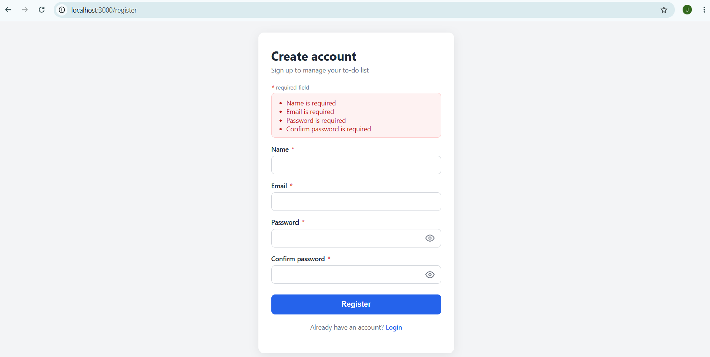
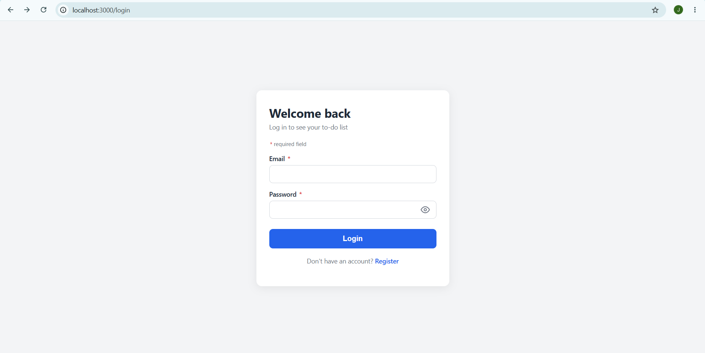
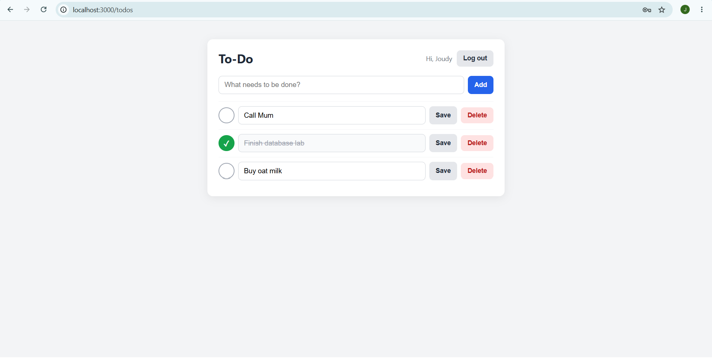
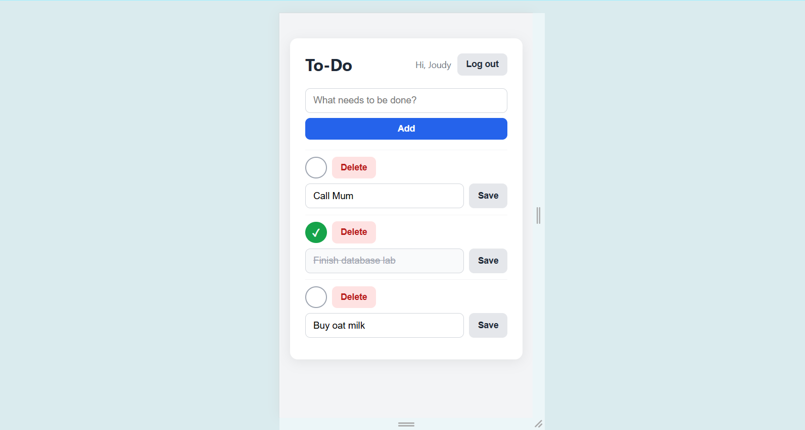

# Lab 2: Login & To-Do Application

Introduction to Database Systems, Fall 2026, Faculty of Engineering, Alexandria National University.

A small web app with sign-up, login and a personal to-do list. Every user sees and manages only their own to-dos.

## 1. Team

| Name | ID |
|---|---|
| Joudy Mohamed Aly | 2304050 |
| Raneem Ahmed Ragab | 2304016 |

**Who did what:** we worked on everything together (database design, back end, front end, validation, testing and this README), sitting side by side and splitting the files between us as we went. Both of us have commits in this repository.Raneem also wrote and tested the register and login pages and checked the answers (a)-(d).

## 2. Technology

- **Back end:** Node.js with Express (`express-session` for sessions, `bcryptjs` for password hashing, `dotenv` for the `.env` file)
- **Front end:** EJS templates, plain HTML, CSS and JavaScript (no framework)
- **Database:** MySQL, database `registration`, accessed with `mysql2` and plain SQL (no ORM)

## 3. How to run it (from an empty machine)

1. Install [Node.js](https://nodejs.org) and MySQL (MySQL Server and MySQL Workbench), and make sure the MySQL server is running.
2. Get the code:
   ```
   git clone https://github.com/JoudyMohamed05/db-lab2-JR.git
   cd db-lab2-JR
   ```
3. Create the database: open `database/schema.sql` in MySQL Workbench and run the whole script. It drops and recreates the database `registration`, so it can be run again and again.
4. Create the `.env` file by copying the example (on Windows use `copy`, on Mac/Linux use `cp`):
   ```
   copy .env.example .env
   ```
   Then open `.env` and fill in your own values (your MySQL user and password, and any long random text for `SESSION_SECRET`):
   ```
   DB_HOST=localhost
   DB_USER=root
   DB_PASSWORD=your-password-here
   DB_NAME=registration
   SESSION_SECRET=change-me
   ```
5. Install the libraries:
   ```
   npm install
   ```
6. Start the server:
   ```
   node app.js
   ```
7. Open <http://localhost:3000> in the browser. You will be sent to the login page. Click **Register** to create the first account.

## 4. Features

| # | Requirement | Done |
|---|---|---|
| R1 | Register with name, email, password and confirm password. A duplicate email shows `Email Already Exists`. After registering the user is logged in and sees the list. | Yes |
| R2 | Login with email and password. A wrong email and a wrong password both show `Invalid email or password`. Logout ends the session. | Yes |
| R3 | The list is private: a visitor who is not logged in is sent to the login page, and a logged-in user sees only their own to-dos, newest first. | Yes |
| R4 | Add a to-do | Yes |
| R5 | Edit the title of a to-do | Yes |
| R6 | Mark a to-do as done / not done | Yes |
| R7 | Delete a to-do (asks "Are you sure?" first) | Yes |
| R8 | Validation in the browser (`public/validate.js`) and again on the server, with the exact messages. When the server finds an error it shows the same page again with the messages and does not touch the database. | Yes |
| R9 | Passwords stored as bcrypt hashes, only the given queries, always with parameters, and `user_id` always comes from the session. | Yes |
| R10 | A user interface that looks good: one consistent style on all pages, works on a 360 px wide screen, clear error messages near the form, done to-dos are crossed out, a friendly text when the list is empty, the user's name and a logout button when logged in, and no raw error pages. There is also a button to show / hide the password. | Yes |

## 5. Screenshots

**Register page with error messages**



**Login page**



**The list with some to-dos (one done)**



**The site in a phone-sized window (360 px)**



## 6. Answers

**(a) Why do `UPDATE` and `DELETE` contain `AND user_id = ?`, and what changes if you remove it?**

The id of a to-do comes from the browser, so anybody can send somebody else's number. With `AND user_id = ?` (the id of the logged-in user, taken from the session) the statement changes zero rows when the to-do is not yours. If we remove it, any logged-in user could edit, mark or delete the to-dos of other users just by changing the number in the request.

**(b) What happens if you insert a to-do for a `user_id` that does not exist, and which constraint of the lecture is that?**

MySQL refuses the insert and gives error 1452 (a foreign key constraint fails), and nothing is added to the table. This is the **foreign key constraint**, which enforces **referential integrity**: every to-do must belong to a user that really exists in `users`.

**(c) Why do you store a hash and not the password?**

If somebody gets the database (a leak, a backup, or a person with access), they should not be able to read the real passwords, especially because many people use the same password on other sites. A hash cannot be turned back into the password. We use bcrypt, which is salted (equal passwords give different hashes) and slow on purpose, so guessing passwords is hard. To log in, the library compares the typed password with the stored hash.

**(d) The `name` column is `NOT NULL`: why did you still need your own check for an empty name?**

Because an empty text `''` is a value, not `NULL`, so `NOT NULL` accepts it. The database only refuses a missing value. So our own checks (in the browser and on the server, after trimming the spaces) are the ones that refuse an empty name and show `Name is required`.
